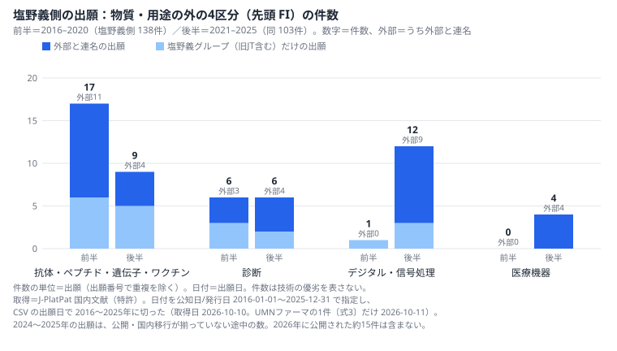
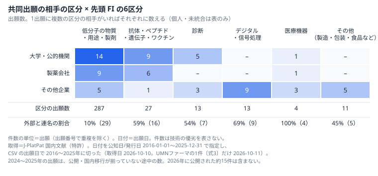

# 塩野義製薬の公開特許と事業情報から見えること

2026年10月時点・公開情報のみ ／ 手法の見本（デモ）。対象企業とは関係のない、個人の学習用の分析です

**この資料の問い**：「パテントに依存しない製品・サービス領域の拡大」を掲げるなか、出願は医薬品の物質・用途の外（とくにデジタル・機器）へ広がっているか。広がっているならどんな連携の形か（新市場の探索）

**副の問い**：JT医薬事業の承継と提携で加わる領域と、その連携相手（連携相手の探索）

**結論（3行）**

1. **事実**：塩野義側（塩野義製薬と子会社の名義）の出願のうち、医薬品の外（診断・デジタル・機器）は 7件→22件。後半の22件のうち17件が外部との連名で、うち10件が企業1社とです（2016〜2020年→2021〜2025年出願。J-PlatPat、2026-10-10取得）
2. **読み**：外から見える範囲では、物質・用途の外への広がりは、抗体・ワクチン等（17件→9件）ではなく、とくにデジタル・機器で、主に企業1社と組んだ形と読めます（仮説1）
3. **仮説**：知財部門がデジタル分野の知財を提案した後に、企業1社との共同研究と連名の出願が続きます（下の表）。この2つにつながりがあるのではないかと考えました（仮説2）。副の問いでは、旧JT側（日本たばこ産業名義の医薬の出願）114件は神経系・代謝・心血管・骨格に厚く、連携相手は出願にほとんど表れていません（外部と連名 4件。仮説3）

**時期の重なり**（事実を並べたもので、つながりは確かめていません）

| 時期 | 出来事（出典） |
|---|---|
| 2020年（聞き取り） | 知財部門がデジタル分野で「どのような知財をいつまでに」創出するかを提案。今後はアライアンスの探索とデジタル・バイオの分野に IPランドスケープを進めたい（特許庁 令和2年度 調査研究報告書 p.304） |
| 2021年12月 | 企業1社と「音刺激による認知機能」の共同研究を開始（2022-06-21 に基本合意。会社の発表） |
| 2022〜2024年 | 音響・音声信号の処理の分類（G10K・G10L）が、この企業との連名の出願で初めて現れる。同社との連名は10件、最初の出願は 2022-06-28（J-PlatPat） |

このつながりがあるか、伺いたいです。

**社内で確かめたい問い（入社後90日）**

- デジタル・機器の出願は、HaaS（医薬品を起点に予防・診断・治療・予後まで支えるサービス）の知財の守り方（特許・意匠・著作権・営業秘密・契約）の中でどんな位置づけか。2020年の提案はその後どう使われているか
- 旧JT医薬事業から加わった領域（神経系・代謝・心血管・骨格など）の連携相手を、IPランドスケープ（会社が挙げる使い道の一つが提携先の探索）でどう探しているか

範囲と限界：公開情報のみ。国内の特許文献だけで、公開前の出願（約1年半。承継〔2025年12月〕後の出願を含む）・WO（国際公開）だけの出願・ノウハウは見えません。件数は出願単位で、技術の優劣を表しません（p.4）。

<!-- pagebreak -->

## 1. 事業と特許の対応

2025年度の売上収益は 4,997億円、うちロイヤリティー収入が 55.8%（ViiV 社向けが 52.3%）、研究開発費は 1,228億円（売上比 24.6%）です。事業は単一セグメント（医薬品事業）で、セグメント別の売上・利益は開示されていません（有価証券報告書 第161期 p.35・38・45・116）。このため、会社が掲げる**重点領域2つ（感染症・社会的影響度の高いQOL疾患）と、変革の方向の HaaS** に分類を対応づけました。

| 会社の言葉 | 対応させた分類 | 塩野義側 前半→後半 | 旧JT側 前半→後半 |
|---|---|---|---|
| 重点領域：感染症 | A61P31・A61P33（抗感染症・抗寄生虫） | 43→34 | 1→0 |
| 重点領域：感染症（ワクチン等） | A61K39（抗原・抗体を含む製剤） | 12→5 | 1→0 |
| 重点領域：QOL疾患（神経系） | A61P25 | 35→7 | 15→23 |
| 重点領域：QOL疾患（免疫・アレルギー／皮膚） | A61P37・A61P17 | 19→8 | 17→14 |
| 重点領域：QOL疾患（感覚器） | A61P27（旧JT側はほとんど眼） | 4→1 | 15→12 |
| HaaS：デジタル・信号処理 | 先頭 FI：G16・G06・G10・H04R・G09 | 1→12 | 0→0 |
| HaaS：医療機器 | 先頭 FI：A61B・A61M・A61H | 0→4 | 0→0 |
| HaaS：診断 | 先頭 FI：G01N・C12Q | 6→6 | 0→1 |
| 土台：低分子の物質・用途・製剤 | 先頭 FI：A61K・A61P・C07D・C07C ほか | 108→70 | 56→53 |

件数＝出願の数（出願単位・出願日）。前半 2016〜2020年／後半 2021〜2025年（2024〜2025年は途中の数。年ごとの件数は付録 C-1）。数え方：A61P・A61K39 の行は付与された FI のどれかに持つ出願（1出願が複数の行に入る）、HaaS と土台の行は先頭 FI による6区分（1出願1区分。付録 C-2）。感染症は A61P31＋A61P33 で、付録 C-3 の図の「抗感染症」（A61P31 だけ、42→33）とは数え方が違う。重点領域の言葉は有報 第161期 p.10-11、HaaS と「パテントに依存しない製品・サービス領域の拡大」は統合報告書2026 p.46-48。売上の区分（ロイヤリティー・国内医療用・海外ほか）と分類は1対1にならない。J-PlatPat、2026-10-10取得（UMNファーマの1件は 2026-10-11）

- **伸びている分類（事実）**：塩野義側のデジタル・信号処理 1→12件、医療機器 0→4件、RNAウイルス（A61P31/14）0→19件。旧JT側の神経系 25%→42%、心血管 19%→33%
- **新しく現れた分類（事実）**：塩野義側に FI のサブクラス10個（付与された FI のどれでも数えた）。音響（G10K）・音声信号の処理（G10L）各7件（2022年〜）、診断のための測定（A61B）5件（2021年〜）など。うち8個は、現れた出願がすべて外部との連名。旧JT側は1個（A23D）。母集団の中での初出で、会社として初めてとは限りません
- **件数が少なくなった分類（事実）**：塩野義側のインフルエンザ（A61P31/16）20→0件、神経系 35→7件、免疫・アレルギー 16→2件、骨格 9→0件
- **読み**：感染症の割合は約3割のまま（31.2%→33.0%）で、中身がインフルエンザから RNAウイルスへ入れ替わります。新型コロナへの対応に出願が移った形とも、ゾフルーザの承認（2018年）前後の後続出願が一段落した形とも読めます。神経系は、医薬の用途の分類とは別に、認知機能の共同研究として信号処理の分類（G10K・G10L 7件）にも出ています（p.4 仮説3）
- **主の問い（事実）**：物質・用途の外の4区分は、塩野義側の 17.4%（24件）→30.1%（31件）。国内先願だけでも 18.3%→27.9% で、国際出願の国内移行の遅れによる見かけだけとは言いにくい形です。中身は診断・デジタル・機器が 7→22件、抗体・ワクチン等は 17→9件（p.1 の図）

<!-- pagebreak -->

## 2. 強みと連携

### 2-1. 質の近似（無料データ）

- **事実**：塩野義側（式1の 240件）のうち、国際出願の国内移行は 109件（45%）。同じ期間の WO（国際公開）は 156件で、先頭の分類の構成は国内と WO でほぼ重なります（低分子 74%／71%）。**読み**：外へ広がる分類も、海外へ出されている形と読めます（件数が少なく、差は読み取れません）

J-PlatPat 国内文献・外国文献の CSV（2026-10-10取得。WO は日本語の名義で拾えた範囲。UMNファーマの1件は WO を出していないので除く）。ファミリーの照合・被引用は取っていない近似で、PatentSight+ 等の商用指標とは別物。

### 2-2. 共同出願人

**事実**：外部と連名の出願は、塩野義側 66／241件（27.4%）、旧JT側 4／114件（3.5%）です。

- **大学・公的機関**（29出願）：北海道大学 10（低分子 7、うち抗感染症 6）、大阪大学 10（抗体等 8、うち抗がん 7）。いずれも会社が公表している連携（北海道大学との抗ウイルス研究〔2006年〜〕、大阪大学の抗CCR8抗体の共同研究講座）と重なります
- **製薬会社**（16出願）：レオ ファーマ社 3（旧JT側）、ロシュ社 2 など。多くは1〜3件です
- **その他企業**（26出願）：企業1社が 10（2022〜2024年）。デジタル・信号処理の外部連名 9件は、すべてこの1社です

J-PlatPat 国内文献 CSV の出願人欄（共同出願人が全員入る）、2026-10-10取得（UMNファーマの1件は 2026-10-11）。外部との連名＝グループ外の名義（大学・企業・個人）が1つでも入る出願。名寄せ：旧JTと塩野義の名義が並ぶ12件は、承継の名義変更が反映された出願とみて（2026-10-10時点）、連携相手に数えていない（付録 B）。

### 2-3. 重要候補3件（仮説）

| 番号 | 発明の名称（短く） | 候補にした理由 |
|---|---|---|
| 特許5971830 | 多環性ピリドン誘導体のプロドラッグ | ゾフルーザの中心とみられる。分割（子1・孫1）。延長登録の通知が複数ある〔経過情報〕 |
| 特許7105430 | ウイルス増殖阻害作用を有するトリアジン誘導体 | ゾコーバの中心とみられる。北海道大学との共同出願で、副の問いの「連携相手」につながる。延長登録の通知がある〔経過情報〕。同日出願の姉妹は拒絶理由2回に補正して登録 |
| 特許6120429 | セファロスポリン誘導体の塩・結晶 | セフィデロコル（フェトロージャ）の製品形態とみられる。延長登録の通知がある〔経過情報〕。同日出願の製剤特許は拒絶理由2回に補正して登録。出願日が2015年で母集団の外 |

経過情報は特許庁「特許情報取得API」（2026-10-10取得）。どの承認に対応する延長かは経過だけでは分からず、公報・登録原簿とは照合していない（経過の詳細は付録 D）。製品との対応は題名・分類・時期からの推測で、請求の範囲は読んでいない。

<!-- pagebreak -->

## 3. 仮説と確かめ方

<table>
<colgroup><col style="width:19%"><col style="width:28%"><col style="width:31%"><col style="width:22%"></colgroup>
<thead><tr><th>仮説</th><th>根拠にした事実</th><th>別の読み方</th><th>確かめ方</th></tr></thead>
<tbody>
<tr><td>1.（主）物質・用途の外への広がりは、抗体等ではなくデジタル・機器で、主に企業1社と組んだ形で始まっている</td><td>外の4区分 17.4%→30.1%（国内先願だけでも 18.3%→27.9%）。診断・デジタル・機器 7→22件（外部連名 3→17、うち企業1社 10）。抗体等 17→9件。後半に初めて現れた10分類のうち8分類は、すべて外部との連名</td><td>件数が少なく（後半 22件）、1社との共同研究の一時的な塊かもしれない（デジタル・信号処理は 2023年 6件・2024年 1件。途中の数）。HaaS の中身はソフト・サービス・ノウハウが多く、特許に出にくい</td><td>デジタル治療・機器の知財を、特許・意匠・著作権・営業秘密・契約のどれで守る方針かを伺う。共同出願の持分・実施の取り決めの型を見る</td></tr>
<tr><td>2.（主）2020年の知財部門のデジタル分野の提案と、企業1社との共同研究・連名の出願がつながっている</td><td>p.1 の表。報告書は 2020年の聞き取り時点。基本合意（2022-06-21）の1週間後に最初の連名の出願（2022-06-28）</td><td>時期が並ぶだけで、出願は共同研究の通常の流れかもしれない。報告書は、提案がどの技術についてかを書いていない</td><td>共同研究の契約・出願のどの段階から知財部門が入ったか、2020年の提案がその後どう使われたかを伺う</td></tr>
<tr><td>3.（副）承継で、塩野義側で後半の出願が少ない低分子の領域に旧JT側の出願が重なり、その領域の連携相手はまだ出願に表れていない</td><td>旧JT側は神経系 25%→42%・心血管 19%→33%・骨格 24%→31%。塩野義側は神経系 35→7件・骨格 9→0件。旧JT側の外部連名 4／114件。外部連名 70件（66＋4）のうち 30件が北海道大学・大阪大学・企業1社</td><td>神経系の取り組みは、認知機能の共同研究として信号処理の分類（G10K・G10L 7件）に出ている。導入品は導入元の名義で、この分類に出ない。旧JT側は同じ題名の後続出願が多い（後半 55件が 30種類）。共同出願になるかは契約の形にもよる（ファルマシア 55(1)、2019年に研究企画部門が紹介した連携の4つの型）</td><td>旧JT由来の研究テーマの領域を、出願の分類と突き合わせる。連携の型ごとに、知財部が出願・契約のどの段階から入るかを伺う。2027年以降の公開を同じ式で追う</td></tr>
</tbody>
</table>

### お役に立てること（提出版で書く欄）

- 〔提出版では、ここに応募者の経験と問いのつながりを1行で書く〕

### 範囲と限界

- 公開情報のみ（J-PlatPat・特許庁API・有価証券報告書・統合報告書・会社の公式サイトと発表・公開文献）。商用DBの指標は使っていません。件数は出願の数で、技術の優劣や権利の強さを表しません。6区分は先頭 FI による近似です
- 日付：論理式入力では日付を「公知日/発行日 2016-01-01〜2025-12-31」で指定し、CSV の出願日で 2016〜2025年に切りました。2026年に公開された約15件は入っていません。2024〜2025年出願は途中の数です。CSV は 2026-10-10 出力（UMNファーマの1件だけ 2026-10-11）
- 旧JT側は医薬の分類（A61K・A61P・C07D・C07K・C07H。A24 を除く）で絞った式で、診断・デジタル・機器が少ないのは式の設計の結果でもあります。承継後の出願はほぼ未公開で、2つの出願群の重なりと違いを見ました
- 名寄せ：塩野義製薬＋子会社（シオノギファーマ・シオノギヘルスケア・鳥居薬品・Qpex 社・UMNファーマ・Shionogi Inc. ほか）。鳥居薬品（2025年8月まで JT の子会社）・Qpex 社（2023年7月取得）・UMNファーマ（2019年子会社化）の取得前の出願も、今の名義で塩野義側に入ります。ViiV 社・田辺三菱製薬（エダラボン。2026年4月承継）・Shionogi-Apnimed 社・IntraBio 社（2026年10月に取得を発表）・中国の1社は未統合です（付録 B）
- HIV の収益の柱（ViiV 社向けロイヤリティー、売上の 52.3%）に当たる特許は、2016年より前の出願か ViiV 社単独の名義とみられ、母集団に現れません（ViiV 社との連名 0件）。WO だけ・外国だけの出願も見えません

最終確認日（社名・数値）：2026-10-11（CSV は 2026-10-10 出力、UMNファーマの1件だけ 2026-10-11）

